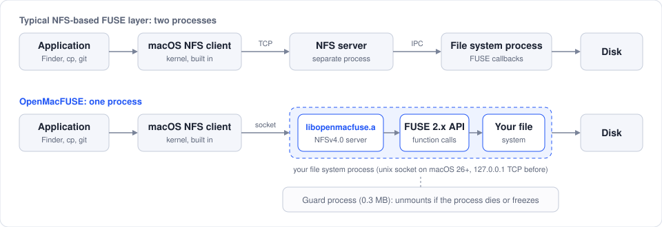

# OpenMacFUSE

[English](README.md) | [简体中文](README.zh-CN.md) | [日本語](README.ja.md) | **Deutsch** | [Français](README.fr.md) | [Español](README.es.md)

**Eine FUSE-2.x-kompatible Bibliothek für macOS, die ohne Kernel-Erweiterung und ohne Installation auskommt.**

OpenMacFUSE betreibt einen NFSv4.0-Server innerhalb des Dateisystemprozesses und hängt ihn mit dem NFS-Client ein, den macOS mitbringt. Die `fuse_operations`-Callbacks bleiben unverändert; statt einer FUSE-Bibliothek wird eine einzige statische Bibliothek gelinkt, `libopenmacfuse.a`.

Es ist die in [NTFSTool Pro](https://ntfstool.com) eingebaute Mount-Engine und trägt dort NTFS-, ext2/3/4-, exFAT- und BitLocker-Volumes. Es wurde für ein ausgeliefertes Produkt geschrieben, und die Messwerte weiter unten stammen aus dieser Arbeit.

> **Status: v0.9 Preview.** Vollständig getestet unter macOS 12 (Intel) und macOS 27 (Apple Silicon). macOS 13 bis 26 sind ungetestet. Siehe [Getestete Systeme](#getestete-systeme).



## Warum

Seit macOS 11 wird eine Kernel-Erweiterung eines Drittanbieters nur noch geladen, nachdem der Benutzer im Wiederherstellungsmodus die Sicherheitsstufe herabgesetzt hat. Für Software, die sich an gewöhnliche Anwender richtet, ist das keine realistische Voraussetzung mehr. Ein Dateisystem im Userspace lässt sich stattdessen über den NFS-Client erreichen, den macOS ohnehin enthält: einen NFS-Server auf demselben Rechner starten, jede NFS-Anfrage in einen Dateisystemaufruf übersetzen und das Ganze mit `mount_nfs` einhängen.

OpenMacFUSE geht diesen Weg und legt den gesamten Server in den Dateisystemprozess:

- **Nichts zu installieren.** Keine Kernel-Erweiterung, keine Systemerweiterung, kein Installer, keine „Reduzierte Sicherheit“ auf Apple Silicon. Eine statische Bibliothek.
- **Ein Prozess.** NFS-Server und Dateisystem teilen sich einen Adressraum. Eine Anfrage gelangt vom Protokolldecoder per Funktionsaufruf zum Callback, ohne zweiten Prozess und ohne zusätzliche Kopie.
- **Begrenzter Speicherverbrauch.** Fester Pufferpool, gedeckelte Knotentabelle, gedeckelte Verzeichnis-Snapshots. Der Speicherverbrauch wächst weder mit der Dateigröße noch mit der Anzahl der Dateien oder der Laufzeit.
- **Fail-closed.** Verschwindet das Gerät, hängt der Prozess oder wird er beendet, wird der Mount innerhalb von Sekunden abgebaut, statt Anwendungen auf einem toten Volume blockieren zu lassen.
- **Mac-Semantik in der Bibliothek.** Erweiterte Attribute ohne `._`-Dateien auf dem Volume, Lookup ohne Beachtung der Groß-/Kleinschreibung, Dateinamen in NFC/NFD.
- **Clean-Room-C.** Rund 17,000 Zeilen, geschrieben anhand von RFC 7530, 7531, 5531 und 4506 sowie der öffentlichen FUSE-2.x-API. Kein Fremdcode. MIT.

## Messwerte

Alle Zahlen wurden vom Entwicklungsteam von NTFSTool gemessen. Derselbe FUSE-Dateisystemquelltext (der NTFS-Treiber aus NTFSTool Pro) wurde zweimal gebaut, einmal gegen OpenMacFUSE und einmal gegen FUSE-T 1.0.49, und auf demselben Rechner mit demselben Volume-Image ausgeführt. Methode, Rechner und die vollständigen Tabellen stehen in [docs/BENCHMARKS.md](docs/BENCHMARKS.md).


Auf echten USB-Datenträgern werden große sequenzielle Übertragungen vom Datenträger begrenzt, beide liegen gleichauf:

| Echter Datenträger | OpenMacFUSE | FUSE-T 1.0.49 |
|---|---|---|
| USB-SSD, sequenzielles Schreiben 4.5 GB | 293-313 MB/s | 300 MB/s |
| USB-SSD, Lesen ohne Cache | 245-251 MB/s | 236-241 MB/s |
| USB-SSD, 2,000 kleine Dateien löschen | 0.82-0.86 s | 8.4-9.7 s |
| USB-SSD, Verzeichnisbaum durchlaufen | 0.25-0.30 s | 4.1-4.6 s |
| USB-Festplatte, Schreiben / Lesen | 70 / 97 MB/s | 74 / 93 MB/s |

Das Anlegen kleiner Dateien ist nicht aufgeführt: Die Standardeinstellung des Dateisystems für die Dauerhaftigkeit von Schreibvorgängen wurde nach diesen Läufen geändert, und der Vergleich wurde noch nicht wiederholt.

Dasselbe Volume-Image, eingehängt auf einem Intel-Mac mit macOS 12.7.6; ein Verzeichnis mit 40,000 Dateien wird aufgelistet und anschließend der Speicherbedarf der Mount-Prozesse ausgelesen:

| OpenMacFUSE | FUSE-T 1.0.49 |
|---|---|
|  |  |
| erstes Auflisten 4.03 s, Speicherbedarf 44 MB | erstes Auflisten 7.87 s, Speicherbedarf 207 MB |

### Wenn etwas schiefgeht

| Ereignis | Was passiert |
|---|---|
| Datenträger während eines Schreibvorgangs abgezogen | der schreibende Prozess erhält einen Fehler, der Mount ist nach 0.2-0.5 s verschwunden |
| Datenträger im Leerlauf oder beim Lesen abgezogen | nach etwa 1.2-1.4 s ausgehängt |
| Eine Anfrage macht 30 s lang keinen Fortschritt | der Watchdog lässt offene Anfragen fehlschlagen, erzwingt das Aushängen und beendet den Prozess |
| Dateisystemprozess stürzt ab oder wird beendet | der Wächterprozess entfernt den Mount nach etwa 2 s |
| Sechs Stunden gemischte Dauerlast | Speicher 45 MB zu Beginn, 51 MB am Ende (+0.27 MB/Stunde) |

Ohne Wächterprozess bleibt der Mount nach dem Tod des NFS-Servers bestehen, bis das `deadtimeout` des Clients abläuft (etwa 70 s), und Prozesse, die darauf zugreifen, lassen sich in dieser Zeit nicht unterbrechen.

## Schnellstart

Voraussetzungen: macOS mit den Xcode Command Line Tools. Sonst nichts.

```sh
git clone https://github.com/ntfstool/openmacfuse
cd openmacfuse
make              # build/libopenmacfuse.a (+ build/openmacfuse-m0, an in-memory test server)
make universal    # arm64 + x86_64
make -C examples/hello
mkdir -p /tmp/hello && examples/hello/hello /tmp/hello
cat /tmp/hello/hello.txt      # Hello from openmacfuse
umount /tmp/hello             # hello exits after the unmount
```

Beim ersten Mount kann macOS für die aufrufende App die Berechtigungsabfrage für „Netzwerkvolumes“ anzeigen. Das ist zu erwarten: Es handelt sich um einen NFS-Mount.

## Einbindung in das eigene Dateisystem

```c
#define FUSE_USE_VERSION 26
#include <fuse.h>
```

```sh
cc -I/path/to/openmacfuse/include -c myfs.c
cc -o myfs myfs.o /path/to/openmacfuse/build/libopenmacfuse.a \
   -lpthread -framework CoreFoundation -framework IOKit
```

Beide Varianten der High-Level-API von FUSE 2.x funktionieren:

```
fuse_main(argc, argv, &ops, NULL)
```

```
fuse_mount → fuse_new → fuse_set_signal_handlers → [daemon()] → fuse_loop → fuse_unmount → fuse_destroy
```

Der Mount ist abgeschlossen, sobald `fuse_new` zurückkehrt. `fuse_loop` kehrt zurück, nachdem das Volume ausgehängt wurde, nachdem das Gerät als verloren gemeldet wurde oder bei SIGINT/SIGTERM/SIGHUP.

[`examples/hello/hello.c`](examples/hello/hello.c) ist ein vollständiges Nur-Lese-Dateisystem in weniger als 150 Zeilen. Ein Dateisystem ist beschreibbar, sobald es einen `write`-Callback bereitstellt und nicht mit `-o ro` eingehängt wird.

### Zwei Dinge, die das Dateisystem leisten muss

1. **`getattr` muss für jedes Objekt eine stabile, eindeutige `st_ino` liefern.** NFS-Datei-Handles werden aus Inode-Nummern gebildet. Lässt das Dateisystem `st_ino` auf null, vergibt die Bibliothek stabile Nummern anhand des Pfads.
2. **`fsync` muss das bedeuten, was `COMMIT` bedeuten soll.** Die Bibliothek ruft `fsync` für NFS-`COMMIT` und für Schreibvorgänge mit `FILE_SYNC` auf und kennt kein anderes Signal für Dauerhaftigkeit.

### Mount-Optionen (`-o`)

| Option | Wirkung |
|---|---|
| `volname=NAME` | Volume-Name, den macOS anzeigt |
| `ro` / `rdonly` | nur lesend einhängen |
| `rwsize=N` | NFS-Lese-/Schreibgröße (Standard 262144) |
| `nobrowse` | Volume nicht im Finder anzeigen |
| `nosuid`, `nodev`, `noexec` | werden an den Mount durchgereicht |
| `openmacfuse_case=insensitive\|sensitive` | Lookup ohne Beachtung der Groß-/Kleinschreibung (Standard). Fällt automatisch auf `sensitive` zurück, wenn das Volume bereits Namen enthält, die sich nur in der Groß-/Kleinschreibung unterscheiden |
| `openmacfuse_xattr=adfile\|appledouble\|streams` | wo erweiterte Attribute abgelegt werden. `adfile` (Standard): Die Bibliothek setzt die `._`-Dateien des Clients in Aufrufe von `setxattr`/`getxattr` um, sodass nichts Zusätzliches auf dem Volume gespeichert wird. `appledouble`: gewöhnliche `._`-Dateien. `streams`: benannte Attribute von NFSv4, experimentell, siehe „Bekannte Einschränkungen“ |
| `openmacfuse_nfc=1\|0` | neue Namen in Unicode NFC speichern (Standard 1). Der Lookup akzeptiert in beiden Fällen NFC und NFD |

Gängige FUSE-Optionen (`local`, `allow_other`, `fsname`, …) werden akzeptiert und ignoriert. Programme, die über `fuse_main` einsteigen, erhalten konservative Standardwerte (`openmacfuse_xattr=appledouble`, `openmacfuse_case=sensitive`), sofern sie diese Optionen nicht selbst übergeben.

### Umgebungsvariablen

| Variable | Standard | Wirkung |
|---|---|---|
| `OPENMACFUSE_TRANSPORT` | `auto` | `unix`, `tcp` oder `auto` (Unix-Socket ab macOS 26+, davor TCP über 127.0.0.1) |
| `OPENMACFUSE_LOG` | — | Log an diese Datei anhängen |
| `OPENMACFUSE_WATCHDOG_S` | 30 | Sekunden ohne Fortschritt, nach denen eine Anfrage als hängend gilt; 0 deaktiviert |
| `OPENMACFUSE_WATCHDOG_MAX_S` | 600 | harte Obergrenze für eine einzelne Anfrage; 0 deaktiviert |
| `OPENMACFUSE_GUARD` | 1 | 0 = Wächterprozess nicht starten |
| `OPENMACFUSE_GUARD_S` | 20 | Sekunden ohne Heartbeat, nach denen der Wächterprozess den Prozess als eingefroren behandelt |
| `OPENMACFUSE_MOUNT_TIMEOUT_S` | 30 | Timeout für `mount_nfs` |

Optionale Erweiterungs-Callbacks (Case-Folding, bereichsweise xattr-Ein-/Ausgabe, Fortschrittszähler für den Watchdog, Mount-Informationen) sind in [`include/openmacfuse.h`](include/openmacfuse.h) deklariert.

## Funktionsweise

Der NFS-Client von macOS ist alt, stabil und immer vorhanden. OpenMacFUSE spricht mit ihm NFSv4.0 über einen lokalen Unix-Socket (macOS 26 und neuer) oder über TCP auf 127.0.0.1 (frühere Versionen; Verbindungen anderer lokaler Prozesse werden dort abgewiesen) und übersetzt jede COMPOUND-Anfrage in High-Level-Callbacks von FUSE.

Einige Entscheidungen, die das Verhalten prägen:

- **Begrenzte Knotentabelle.** Ein Datei-Handle ist kein Zeiger auf ein Objekt im Speicher. Die Tabelle hat eine Obergrenze; ein verdrängtes Handle wird bei der nächsten Verwendung erneut über den Pfad aufgelöst. Mit einer auf 64 Einträge heruntergesetzten Obergrenze und 301 Umbenennungen in Folge wurden alle 7,839 Lookups alter Handles aufgelöst, keiner lieferte `NFS4ERR_STALE`.
- **Duplicate Request Cache.** Der Client sendet Anfragen nach einem Timeout erneut. Antworten auf nicht idempotente Operationen (`CREATE`, `REMOVE`, `RENAME`, …) werden zwischengespeichert und erneut ausgeliefert, sodass die Operation nur einmal ausgeführt wird.
- **Standardmäßig keine benannten Attribute.** Benannte Attribute von NFSv4 wären der naheliegende Ort für erweiterte Attribute, doch ihre Aktivierung führte während der Entwicklung zu einer Kernel-Panic im NFS-Client von macOS (beobachtet unter macOS 27.0.1 und 12.7.6). Der Standardpfad nutzt nur das, was der Client am häufigsten verwendet.

Entwurfsnotizen und Abwägungen beim Protokoll: [docs/DESIGN.md](docs/DESIGN.md).

## Getestete Systeme

| macOS | Hardware | Ergebnis |
|---|---|---|
| 12.7.6 | Intel (MacBookPro11,4) | vollständige Suite, 869 automatisierte Prüfungen bestanden |
| 27.0.1 | Apple Silicon (M2) | Lesen/Schreiben, simuliertes Abziehen, Kill, Suite zur Mac-Semantik bestanden |
| 13, 14, 15, 26 | — | **ungetestet** |

Die vollständige Suite arbeitet mit echten Dateisystemen (NTFS, ext, exFAT), die nicht Teil dieses Repositorys sind. Aus diesem Repository heraus lässt sich Folgendes ausführen:

```sh
make test               # unit tests, no mount
tests/m0_smoke.sh       # mount the in-memory server, read, unmount
```

## Bekannte Einschränkungen

- **Ungetestete macOS-Versionen**: 13, 14, 15, 26.
- **Für macOS ist das Volume ein Netzwerkvolume.** Kein Papierkorb, und das erste Öffnen eines sehr großen Verzeichnisses (40,000+ Einträge) im Finder ist langsam.
- **Eine Kernel-Panic im NFS-Client von macOS lässt sich aus dem Userspace nicht abfangen.** Die beiden Pfade, auf die wir während der Entwicklung gestoßen sind (benannte Attribute; Abbruch eines Mounts, dessen Server nicht antwortet), werden standardmäßig vermieden.
- **API-Abdeckung**: High-Level-API von FUSE 2.x. Nicht enthalten: die Low-Level-API, FUSE 3.
- **Callbacks werden serialisiert** (ein globaler Lock). Eine langsame Anfrage auf einem langsamen Gerät verzögert andere Anfragen auf demselben Mount.
- **Keine Inode-Generationsnummern** in FUSE 2.x: Wenn das Dateisystem Inode-Nummern nach dem Löschen wiederverwendet, kann ein Client mit einem alten Handle die neue Datei erreichen.
- **Datei-Flags**: „Unsichtbar“ und „Archiv“ werden an den `chflags`-Callback durchgereicht. Das Finder-Flag „Geschützt“ (`uchg`) nicht; der NFS-Client von macOS weist es ab, ohne eine Anfrage zu senden.

## Verwandte Projekte

- [NTFSTool Pro](https://ntfstool.com): NTFS-Lese- und Schreibzugriff für den Mac, mit ext2/3/4, exFAT-Wiederherstellung und BitLocker. OpenMacFUSE ist die eingebaute Mount-Engine.
- [ntfstool/ntfstool](https://github.com/ntfstool/ntfstool): das kostenlose, quelloffene NTFSTool auf Basis von Apple FSKit.

OpenMacFUSE ist eine von wenigen quelloffenen FUSE-Implementierungen für macOS, die keine Kernel-Erweiterung benötigen. Es ist ein unabhängiges Projekt und steht in keiner Verbindung zu macFUSE oder dessen Autoren, ebenso wenig zu den Projekten libfuse oder FUSE-T. „FUSE“ bezeichnet die API.

## Mitwirken

Siehe [CONTRIBUTING.md](CONTRIBUTING.md). Sicherheitsprobleme: service@ntfstool.com.

## Lizenz

MIT. Siehe [LICENSE](LICENSE) und [NOTICE](NOTICE).
