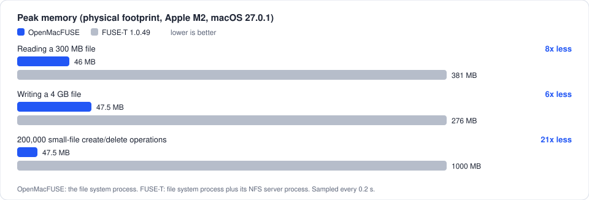

# OpenMacFUSE

[English](README.md) | [简体中文](README.zh-CN.md) | [日本語](README.ja.md) | [Deutsch](README.de.md) | [Français](README.fr.md) | **Español**

**Una biblioteca compatible con FUSE 2.x para macOS que no necesita extensión del kernel ni instalar nada.**

OpenMacFUSE ejecuta un servidor NFSv4.0 dentro del proceso de tu sistema de archivos y lo monta con el cliente NFS que incluye macOS. Tus callbacks de `fuse_operations` no cambian; enlazas una única biblioteca estática, `libopenmacfuse.a`, en lugar de una biblioteca FUSE.

Es el motor de montaje integrado en [NTFSTool Pro](https://ntfstool.com), donde da servicio a volúmenes NTFS, ext2/3/4, exFAT y BitLocker. Se escribió para un producto que está en el mercado, y las mediciones que siguen proceden de ese trabajo.

> **Estado: versión preliminar v0.9.** Probado por completo en macOS 12 (Intel) y macOS 27 (chip de Apple). macOS 13 a 26 están sin probar. Consulta [Sistemas probados](#sistemas-probados).


## Por qué

Desde macOS 11, una extensión del kernel de terceros solo se carga después de que el usuario rebaje el nivel de seguridad en el modo de recuperación. Para un software dirigido a usuarios corrientes, ese requisito ya no es realista. A un sistema de archivos en espacio de usuario se puede llegar, en cambio, a través del cliente NFS que macOS ya trae: se ejecuta un servidor NFS en la misma máquina, se traduce cada solicitud NFS a una llamada al sistema de archivos y se monta con `mount_nfs`.

OpenMacFUSE sigue ese camino y mete todo el servidor dentro del proceso del sistema de archivos:

- **Nada que instalar.** Ni extensión del kernel, ni extensión del sistema, ni instalador, ni «Seguridad reducida» en equipos con chip de Apple. Una biblioteca estática.
- **Un solo proceso.** El servidor NFS y el sistema de archivos comparten espacio de direcciones. Una solicitud va del decodificador del protocolo a tu callback mediante una llamada a función, sin un segundo proceso y sin copias adicionales.
- **Memoria acotada.** Pool de búferes fijo, tabla de nodos con tope, instantáneas de directorio con tope. La memoria no crece con el tamaño de los archivos, con su número ni con el tiempo en marcha.
- **Fallo cerrado (fail closed).** Si el dispositivo desaparece, el proceso se cuelga o lo matan, el montaje se retira en cuestión de segundos en lugar de dejar las aplicaciones bloqueadas en un volumen muerto.
- **La semántica de Mac se resuelve en la biblioteca.** Atributos extendidos sin archivos `._` en el volumen, búsqueda sin distinción de mayúsculas y minúsculas, nombres de archivo NFC/NFD.
- **C escrito en sala limpia (clean room).** Unas 17,000 líneas, escritas a partir de las RFC 7530, 7531, 5531 y 4506 y de la API pública de FUSE 2.x. Sin código de terceros. MIT.

## Mediciones

Todas las cifras las midió el equipo de ingeniería de NTFSTool. El mismo código fuente de sistema de archivos FUSE (el controlador NTFS de NTFSTool Pro) se compiló dos veces, una contra OpenMacFUSE y otra contra FUSE-T 1.0.49, y se ejecutó en la misma máquina con la misma imagen de volumen. El método, las máquinas y las tablas completas están en [docs/BENCHMARKS.md](docs/BENCHMARKS.md).




En discos USB reales, las transferencias secuenciales grandes están limitadas por el disco y ambos quedan igualados:

| Disco real | OpenMacFUSE | FUSE-T 1.0.49 |
|---|---|---|
| SSD USB, escritura secuencial de 4.5 GB | 293-313 MB/s | 300 MB/s |
| SSD USB, lectura en frío | 245-251 MB/s | 236-241 MB/s |
| SSD USB, borrar 2,000 archivos pequeños | 0.82-0.86 s | 8.4-9.7 s |
| SSD USB, recorrer el árbol de directorios | 0.25-0.30 s | 4.1-4.6 s |
| Disco duro USB, escritura / lectura | 70 / 97 MB/s | 74 / 93 MB/s |

La creación de archivos pequeños no figura: el ajuste de durabilidad por defecto del sistema de archivos cambió después de estas pruebas y esa comparación no se ha repetido.

La misma imagen de volumen montada en un Mac Intel con macOS 12.7.6, listando un directorio de 40,000 archivos y leyendo después la huella de memoria de los procesos de montaje:

| OpenMacFUSE | FUSE-T 1.0.49 |
|---|---|
|  |  |
| primer listado 4.06 s, huella 43 MB | primer listado 7.90 s, huella 209 MB |

### Cuando algo va mal

| Evento | Qué ocurre |
|---|---|
| Disco desconectado durante una escritura | el proceso que escribe recibe un error y el montaje desaparece en 0.2-0.5 s |
| Disco desconectado en reposo o durante una lectura | se desmonta en unos 1.2-1.4 s |
| Una solicitud no avanza durante 30 s | el watchdog hace fallar las solicitudes pendientes, fuerza el desmontaje y termina |
| El proceso del sistema de archivos se cae o lo matan | el proceso guardián retira el montaje en unos 2 s |
| Seis horas de carga mixta continua | memoria de 45 MB al inicio, 51 MB al final (+0.27 MB/hora) |

Sin proceso guardián, un servidor NFS muerto deja el montaje en su sitio hasta que vence el `deadtimeout` del cliente (unos 70 s), y los procesos que lo tocan no se pueden interrumpir mientras tanto.

## Inicio rápido

Requisitos: macOS con las Xcode Command Line Tools. Nada más.

```sh
git clone https://github.com/ntfstool/openmacfuse
cd openmacfuse
make              # build/libopenmacfuse.a (+ build/openmacfuse-m0, an in-memory test server)
make universal    # arm64 + x86_64
make -C examples/hello
mkdir -p /tmp/hello && examples/hello/hello /tmp/hello
cat /tmp/hello/hello.txt      # Hello from openmacfuse
umount /tmp/hello             # hello exits after the unmount
```

El primer montaje puede hacer que macOS muestre a la app que lo invoca la solicitud de permiso de «volúmenes de red». Es lo esperado: se trata de un montaje NFS.

## Uso en tu sistema de archivos

```c
#define FUSE_USE_VERSION 26
#include <fuse.h>
```

```sh
cc -I/path/to/openmacfuse/include -c myfs.c
cc -o myfs myfs.o /path/to/openmacfuse/build/libopenmacfuse.a \
   -lpthread -framework CoreFoundation -framework IOKit
```

Funcionan los dos estilos de la API de alto nivel de FUSE 2.x:

```
fuse_main(argc, argv, &ops, NULL)
```

```
fuse_mount → fuse_new → fuse_set_signal_handlers → [daemon()] → fuse_loop → fuse_unmount → fuse_destroy
```

El montaje está completo cuando `fuse_new` retorna. `fuse_loop` retorna después de que se desmonte el volumen, después de que se notifique la pérdida del dispositivo, o al recibir SIGINT/SIGTERM/SIGHUP.

[`examples/hello/hello.c`](examples/hello/hello.c) es un sistema de archivos de solo lectura completo en menos de 150 líneas. Un sistema de archivos pasa a ser de lectura y escritura cuando proporciona un callback `write` y no se monta con `-o ro`.

### Dos cosas que tu sistema de archivos debe hacer

1. **Devolver desde `getattr` un `st_ino` estable y único** para cada objeto. Los manejadores de archivo (file handles) de NFS se construyen a partir de los números de inodo. Si tu sistema de archivos deja `st_ino` a cero, la biblioteca asigna números estables a partir de la ruta.
2. **Hacer que `fsync` signifique lo que quieres que signifique `COMMIT`.** La biblioteca llama a `fsync` para los `COMMIT` de NFS y las escrituras `FILE_SYNC`, y no dispone de ninguna otra señal de durabilidad.

### Opciones de montaje (`-o`)

| Opción | Efecto |
|---|---|
| `volname=NAME` | nombre del volumen que muestra macOS |
| `ro` / `rdonly` | montaje de solo lectura |
| `rwsize=N` | tamaño de lectura/escritura de NFS (por defecto 262144) |
| `nobrowse` | no mostrar el volumen en el Finder |
| `nosuid`, `nodev`, `noexec` | se pasan al montaje |
| `openmacfuse_case=insensitive\|sensitive` | búsqueda sin distinción de mayúsculas y minúsculas (por defecto). Vuelve automáticamente a `sensitive` cuando el volumen ya contiene nombres que solo difieren en mayúsculas y minúsculas |
| `openmacfuse_xattr=adfile\|appledouble\|streams` | dónde se guardan los atributos extendidos. `adfile` (por defecto): la biblioteca convierte los archivos `._` del cliente en llamadas a tus `setxattr`/`getxattr`, de modo que no se almacena nada adicional en el volumen. `appledouble`: archivos `._` normales. `streams`: atributos con nombre de NFSv4, experimental, consulta «Limitaciones conocidas» |
| `openmacfuse_nfc=1\|0` | guardar los nombres nuevos en Unicode NFC (por defecto 1). La búsqueda acepta NFC y NFD en ambos casos |

Las opciones habituales de FUSE (`local`, `allow_other`, `fsname`, …) se aceptan y se ignoran. Los programas que entran por `fuse_main` reciben valores por defecto conservadores (`openmacfuse_xattr=appledouble`, `openmacfuse_case=sensitive`), salvo que pasen ellos mismos estas opciones.

### Variables de entorno

| Variable | Valor por defecto | Efecto |
|---|---|---|
| `OPENMACFUSE_TRANSPORT` | `auto` | `unix`, `tcp` o `auto` (socket unix en macOS 26+, TCP en 127.0.0.1 antes) |
| `OPENMACFUSE_LOG` | — | añadir el registro al final de este archivo |
| `OPENMACFUSE_WATCHDOG_S` | 30 | segundos sin avance antes de considerar colgada una solicitud; 0 lo desactiva |
| `OPENMACFUSE_WATCHDOG_MAX_S` | 600 | límite estricto para una solicitud; 0 lo desactiva |
| `OPENMACFUSE_GUARD` | 1 | 0 = no iniciar el proceso guardián |
| `OPENMACFUSE_GUARD_S` | 20 | segundos sin latido antes de que el proceso guardián dé el proceso por congelado |
| `OPENMACFUSE_MOUNT_TIMEOUT_S` | 30 | tiempo de espera de `mount_nfs` |

Los callbacks de extensión opcionales (plegado de mayúsculas y minúsculas, E/S de xattr por rangos, contador de avance para el watchdog, información del montaje) están declarados en [`include/openmacfuse.h`](include/openmacfuse.h).

## Cómo funciona

El cliente NFS de macOS es antiguo, estable y siempre está presente. OpenMacFUSE habla NFSv4.0 con él a través de un socket unix local (macOS 26 y posteriores) o de TCP en 127.0.0.1 (versiones anteriores, en las que se rechazan las conexiones de otros procesos locales), y traduce cada solicitud COMPOUND a callbacks de alto nivel de FUSE.

Algunas decisiones que determinan su comportamiento:

- **Tabla de nodos acotada.** Un manejador de archivo no es un puntero a un objeto en memoria. La tabla tiene un tope; un manejador desalojado se vuelve a resolver por su ruta la siguiente vez que se usa. Con el tope forzado a 64 entradas y 301 renombrados seguidos, las 7,839 búsquedas de manejadores antiguos se resolvieron y ninguna devolvió `NFS4ERR_STALE`.
- **Caché de solicitudes duplicadas.** El cliente reenvía las solicitudes tras un tiempo de espera. Las respuestas a operaciones no idempotentes (`CREATE`, `REMOVE`, `RENAME`, …) se guardan en caché y se reproducen, de modo que la operación se ejecuta una sola vez.
- **Sin atributos con nombre por defecto.** Los atributos con nombre de NFSv4 son el lugar natural para los atributos extendidos, pero activarlos provocó un kernel panic en el cliente NFS de macOS durante el desarrollo (observado en macOS 27.0.1 y 12.7.6). La ruta por defecto usa solo lo que el cliente ejercita con más frecuencia.

Notas de diseño y compromisos del protocolo: [docs/DESIGN.md](docs/DESIGN.md).

## Sistemas probados

| macOS | Hardware | Resultado |
|---|---|---|
| 12.7.6 | Intel (MacBookPro11,4) | suite completa, 869 comprobaciones automatizadas superadas |
| 27.0.1 | Chip de Apple (M2) | lectura/escritura, desconexión simulada, kill y suite de semántica de Mac superadas |
| 13, 14, 15, 26 | — | **sin probar** |

La suite completa ejercita sistemas de archivos reales (NTFS, ext, exFAT) que no forman parte de este repositorio. Lo que puedes ejecutar desde este repositorio:

```sh
make test               # unit tests, no mount
tests/m0_smoke.sh       # mount the in-memory server, read, unmount
```

## Limitaciones conocidas

- **Versiones de macOS sin probar**: 13, 14, 15, 26.
- **Para macOS, el volumen es un volumen de red.** No hay Papelera, y la primera vez que el Finder abre un directorio muy grande (40,000+ entradas) tarda.
- **Un kernel panic en el cliente NFS de macOS no se puede capturar desde el espacio de usuario.** Las dos rutas con las que nos topamos durante el desarrollo (atributos con nombre; interrumpir un montaje cuyo servidor no responde) se evitan por defecto.
- **Cobertura de la API**: API de alto nivel de FUSE 2.x. No se ofrecen: la API de bajo nivel, FUSE 3.
- **Los callbacks se serializan** (un único bloqueo global). Una solicitud lenta en un dispositivo lento retrasa las demás solicitudes del mismo montaje.
- **No hay números de generación de inodo** en FUSE 2.x: si tu sistema de archivos reutiliza números de inodo después de un borrado, un cliente que conserve un manejador antiguo puede llegar al archivo nuevo.
- **Indicadores de archivo**: los de oculto y archivo se transmiten a tu callback `chflags`. El indicador «Bloqueado» del Finder (`uchg`) no; el cliente NFS de macOS lo rechaza sin enviar ninguna solicitud.

## Proyectos relacionados

- [NTFSTool Pro](https://ntfstool.com): lectura y escritura de NTFS para Mac, con ext2/3/4, recuperación de exFAT y BitLocker. OpenMacFUSE es su motor de montaje integrado.
- [ntfstool/ntfstool](https://github.com/ntfstool/ntfstool): el NTFSTool gratuito y de código abierto, construido sobre Apple FSKit.

OpenMacFUSE es una de las pocas implementaciones de FUSE de código abierto para macOS que no necesitan extensión del kernel. Es un proyecto independiente y no está afiliado a macFUSE ni a sus autores, ni tampoco a los proyectos libfuse o FUSE-T. «FUSE» se refiere a la API.

## Contribuir

Consulta [CONTRIBUTING.md](CONTRIBUTING.md). Problemas de seguridad: service@ntfstool.com.

## Licencia

MIT. Consulta [LICENSE](LICENSE) y [NOTICE](NOTICE).
