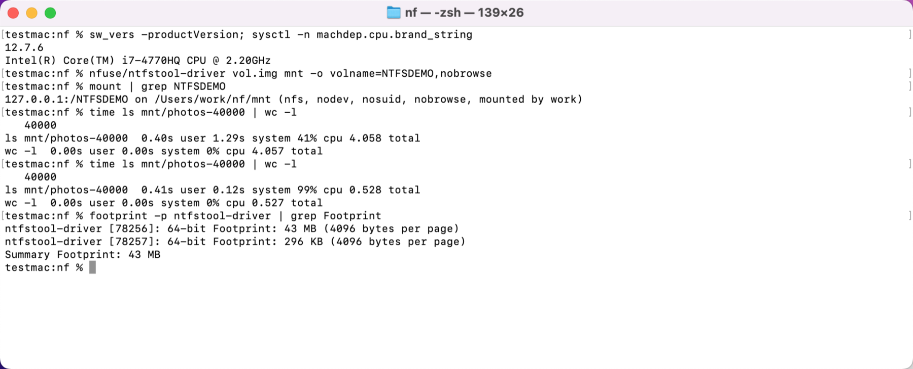
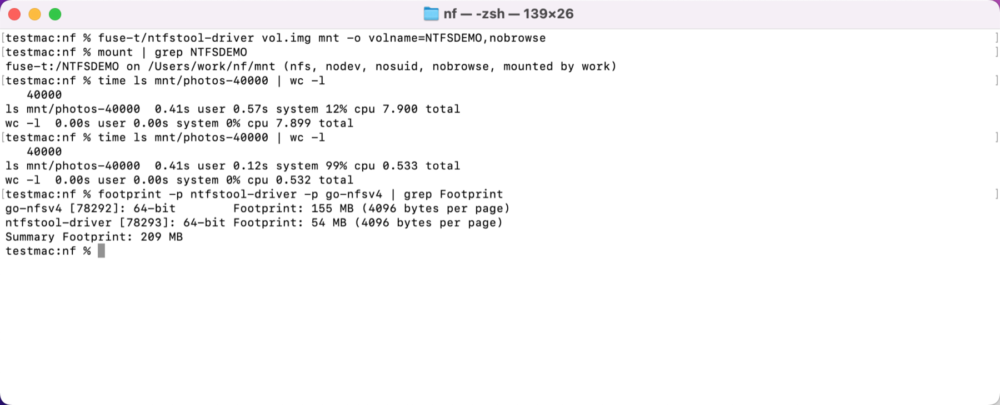

# OpenMacFUSE

[English](README.md) | [简体中文](README.zh-CN.md) | [日本語](README.ja.md) | [Deutsch](README.de.md) | **Français** | [Español](README.es.md)

**Une bibliothèque compatible FUSE 2.x pour macOS, sans extension du noyau et sans rien à installer.**

OpenMacFUSE exécute un serveur NFSv4.0 dans le processus de votre système de fichiers et le monte avec le client NFS fourni avec macOS. Vos callbacks `fuse_operations` restent les mêmes ; vous liez une seule bibliothèque statique, `libnfuse.a`, à la place d'une bibliothèque FUSE.

C'est le moteur de montage intégré à [NTFSTool Pro](https://ntfstool.com), où il prend en charge les volumes NTFS, ext2/3/4, exFAT et BitLocker. Il a été écrit pour un produit commercialisé, et les mesures ci-dessous proviennent de ce travail.

> **État : préversion v0.9.** Entièrement testé sur macOS 12 (Intel) et macOS 27 (puce Apple). macOS 13 à 26 ne sont pas testés. Voir [Systèmes testés](#systèmes-testés).


## Pourquoi

Depuis macOS 11, une extension du noyau tierce ne se charge qu'après que l'utilisateur a abaissé le niveau de sécurité en mode de récupération. Pour un logiciel destiné au grand public, ce n'est plus une exigence réaliste. Un système de fichiers en espace utilisateur peut à la place être atteint par le client NFS que macOS possède déjà : on lance un serveur NFS sur la même machine, on traduit chaque requête NFS en appel au système de fichiers, et on monte le tout avec `mount_nfs`.

OpenMacFUSE suit cette voie et place tout le serveur dans le processus du système de fichiers :

- **Rien à installer.** Pas d'extension du noyau, pas d'extension système, pas d'installeur, pas de « Sécurité réduite » sur les puces Apple. Une bibliothèque statique.
- **Un seul processus.** Le serveur NFS et le système de fichiers partagent un espace d'adressage. Une requête passe du décodeur de protocole à votre callback par un appel de fonction, sans second processus ni copie supplémentaire.
- **Mémoire bornée.** Pool de tampons fixe, table de nœuds plafonnée, instantanés de répertoires plafonnés. La mémoire ne croît ni avec la taille des fichiers, ni avec leur nombre, ni avec la durée de fonctionnement.
- **Défaillance en mode fermé (fail closed).** Si le périphérique disparaît, si le processus se bloque ou s'il est tué, le montage est retiré en quelques secondes au lieu de laisser les applications bloquées sur un volume mort.
- **Sémantique Mac gérée dans la bibliothèque.** Attributs étendus sans fichiers `._` sur le volume, recherche insensible à la casse, noms de fichiers NFC/NFD.
- **C écrit en salle blanche (clean room).** Environ 17,000 lignes, écrites à partir des RFC 7530, 7531, 5531 et 4506 et de l'API publique FUSE 2.x. Aucun code tiers. MIT.

## Mesures

Tous les chiffres ont été mesurés par l'équipe d'ingénierie de NTFSTool. Le même code source de système de fichiers FUSE (le pilote NTFS de NTFSTool Pro) a été compilé deux fois, une fois avec OpenMacFUSE et une fois avec FUSE-T 1.0.49, puis exécuté sur la même machine avec la même image de volume. La méthode, les machines et les tableaux complets se trouvent dans [docs/BENCHMARKS.md](docs/BENCHMARKS.md).


Sur de vrais disques USB, les gros transferts séquentiels sont limités par le disque et les deux font jeu égal :

| Disque réel | OpenMacFUSE | FUSE-T 1.0.49 |
|---|---|---|
| SSD USB, écriture séquentielle de 4.5 GB | 293-313 MB/s | 300 MB/s |
| SSD USB, lecture à froid | 245-251 MB/s | 236-241 MB/s |
| SSD USB, suppression de 2,000 petits fichiers | 0.82-0.86 s | 8.4-9.7 s |
| SSD USB, parcours de l'arborescence | 0.25-0.30 s | 4.1-4.6 s |
| Disque dur USB, écriture / lecture | 70 / 97 MB/s | 74 / 93 MB/s |

La création de petits fichiers n'est pas indiquée : le réglage de durabilité par défaut du système de fichiers a changé après ces essais et la comparaison n'a pas été refaite.

La même image de volume montée sur un Mac Intel sous macOS 12.7.6, avec le listage d'un répertoire de 40,000 fichiers puis le relevé de l'empreinte mémoire des processus de montage :

| OpenMacFUSE | FUSE-T 1.0.49 |
|---|---|
|  |  |
| premier listage 4.06 s, empreinte 43 MB | premier listage 7.90 s, empreinte 209 MB |

### En cas de problème

| Événement | Ce qui se passe |
|---|---|
| Disque débranché pendant une écriture | le processus qui écrit reçoit une erreur et le montage disparaît en 0.2-0.5 s |
| Disque débranché au repos ou en lecture | démonté en 1.2-1.4 s environ |
| Une requête ne progresse plus pendant 30 s | le watchdog fait échouer les requêtes en attente, force le démontage, puis quitte |
| Le processus du système de fichiers plante ou est tué | le processus de garde retire le montage en 2 s environ |
| Six heures de charge mixte continue | mémoire de 45 MB au début, 51 MB à la fin (+0.27 MB/heure) |

Sans processus de garde, un serveur NFS mort laisse le montage en place jusqu'à l'expiration du `deadtimeout` du client (environ 70 s), et les processus qui y accèdent ne peuvent pas être interrompus dans l'intervalle.

## Démarrage rapide

Prérequis : macOS avec les Xcode Command Line Tools. Rien d'autre.

```sh
git clone https://github.com/ntfstool/openmacfuse
cd openmacfuse
make              # build/libnfuse.a (+ build/nfuse-m0, an in-memory test server)
make universal    # arm64 + x86_64
make -C examples/hello
mkdir -p /tmp/hello && examples/hello/hello /tmp/hello
cat /tmp/hello/hello.txt      # Hello from nfuse
umount /tmp/hello             # hello exits after the unmount
```

Le premier montage peut déclencher la demande d'autorisation « volumes réseau » de macOS pour l'application appelante. C'est normal : il s'agit d'un montage NFS.

La bibliothèque et ses identifiants portent le nom `nfuse` (`libnfuse.a`, `nfuse.h`, `NFUSE_*`). OpenMacFUSE est le nom du projet.

## Utilisation dans votre système de fichiers

```c
#define FUSE_USE_VERSION 26
#include <fuse.h>
```

```sh
cc -I/path/to/openmacfuse/include -c myfs.c
cc -o myfs myfs.o /path/to/openmacfuse/build/libnfuse.a \
   -lpthread -framework CoreFoundation -framework IOKit
```

Les deux styles de l'API de haut niveau de FUSE 2.x fonctionnent :

```
fuse_main(argc, argv, &ops, NULL)
```

```
fuse_mount → fuse_new → fuse_set_signal_handlers → [daemon()] → fuse_loop → fuse_unmount → fuse_destroy
```

Le montage est terminé au retour de `fuse_new`. `fuse_loop` retourne après le démontage du volume, après le signalement de la perte du périphérique, ou sur SIGINT/SIGTERM/SIGHUP.

[`examples/hello/hello.c`](examples/hello/hello.c) est un système de fichiers complet en lecture seule, en moins de 150 lignes. Un système de fichiers devient accessible en lecture-écriture dès qu'il fournit un callback `write` et qu'il n'est pas monté avec `-o ro`.

### Deux choses que votre système de fichiers doit faire

1. **Renvoyer depuis `getattr` un `st_ino` stable et unique** pour chaque objet. Les handles de fichiers NFS sont construits à partir des numéros d'inode. Si votre système de fichiers laisse `st_ino` à zéro, la bibliothèque attribue des numéros stables à partir du chemin.
2. **Donner à `fsync` le sens que vous voulez donner à `COMMIT`.** La bibliothèque appelle `fsync` pour les `COMMIT` NFS et les écritures `FILE_SYNC`, et ne dispose d'aucun autre signal de durabilité.

### Options de montage (`-o`)

| Option | Effet |
|---|---|
| `volname=NAME` | nom du volume affiché par macOS |
| `ro` / `rdonly` | montage en lecture seule |
| `rwsize=N` | taille de lecture/écriture NFS (262144 par défaut) |
| `nobrowse` | ne pas afficher le volume dans le Finder |
| `nosuid`, `nodev`, `noexec` | transmises au montage |
| `nfuse_case=insensitive\|sensitive` | recherche insensible à la casse (par défaut). Repasse automatiquement à `sensitive` lorsque le volume contient déjà des noms qui ne diffèrent que par la casse |
| `nfuse_xattr=adfile\|appledouble\|streams` | emplacement des attributs étendus. `adfile` (par défaut) : la bibliothèque transforme les fichiers `._` du client en appels à vos `setxattr`/`getxattr`, de sorte que rien de plus n'est stocké sur le volume. `appledouble` : fichiers `._` ordinaires. `streams` : attributs nommés NFSv4, expérimental, voir « Limitations connues » |
| `nfuse_nfc=1\|0` | enregistrer les nouveaux noms en Unicode NFC (1 par défaut). La recherche accepte NFC et NFD dans les deux cas |

Les options FUSE courantes (`local`, `allow_other`, `fsname`, …) sont acceptées et ignorées. Les programmes qui passent par `fuse_main` reçoivent des valeurs par défaut prudentes (`nfuse_xattr=appledouble`, `nfuse_case=sensitive`), sauf s'ils fournissent eux-mêmes ces options.

### Variables d'environnement

| Variable | Valeur par défaut | Effet |
|---|---|---|
| `NFUSE_TRANSPORT` | `auto` | `unix`, `tcp` ou `auto` (socket unix sur macOS 26+, TCP sur 127.0.0.1 avant) |
| `NFUSE_LOG` | — | ajouter le journal à la fin de ce fichier |
| `NFUSE_WATCHDOG_S` | 30 | secondes sans progression avant qu'une requête soit considérée comme bloquée ; 0 désactive |
| `NFUSE_WATCHDOG_MAX_S` | 600 | limite stricte pour une requête ; 0 désactive |
| `NFUSE_GUARD` | 1 | 0 = ne pas lancer le processus de garde |
| `NFUSE_GUARD_S` | 20 | secondes sans battement de cœur avant que le processus de garde considère le processus comme figé |
| `NFUSE_MOUNT_TIMEOUT_S` | 30 | délai d'expiration de `mount_nfs` |

Les callbacks d'extension facultatifs (pliage de casse, E/S xattr par plage, compteur de progression pour le watchdog, informations de montage) sont déclarés dans [`include/nfuse.h`](include/nfuse.h).

## Fonctionnement

Le client NFS de macOS est ancien, stable et toujours présent. OpenMacFUSE lui parle en NFSv4.0 via un socket unix local (macOS 26 et versions ultérieures) ou en TCP sur 127.0.0.1 (versions antérieures, où les connexions d'autres processus locaux sont rejetées), et traduit chaque requête COMPOUND en callbacks de haut niveau FUSE.

Quelques décisions qui déterminent son comportement :

- **Table de nœuds bornée.** Un handle de fichier n'est pas un pointeur vers un objet en mémoire. La table a un plafond ; un handle évincé est résolu de nouveau par son chemin à l'utilisation suivante. Avec un plafond abaissé de force à 64 entrées et 301 renommages d'affilée, les 7,839 recherches d'anciens handles ont toutes abouti et aucune n'a renvoyé `NFS4ERR_STALE`.
- **Cache des requêtes dupliquées.** Le client renvoie ses requêtes après un délai d'expiration. Les réponses aux opérations non idempotentes (`CREATE`, `REMOVE`, `RENAME`, …) sont mises en cache et rejouées, de sorte que l'opération ne s'exécute qu'une fois.
- **Pas d'attributs nommés par défaut.** Les attributs nommés NFSv4 sont l'emplacement naturel des attributs étendus, mais leur activation a provoqué une panique du noyau dans le client NFS de macOS pendant le développement (observée sur macOS 27.0.1 et 12.7.6). Le chemin par défaut n'utilise que ce que le client sollicite le plus.

Notes de conception et compromis de protocole : [docs/DESIGN.md](docs/DESIGN.md).

## Systèmes testés

| macOS | Matériel | Résultat |
|---|---|---|
| 12.7.6 | Intel (MacBookPro11,4) | suite complète, 869 vérifications automatisées réussies |
| 27.0.1 | Puce Apple (M2) | lecture/écriture, débranchement simulé, kill, suite de sémantique Mac réussis |
| 13, 14, 15, 26 | — | **non testé** |

La suite complète pilote de vrais systèmes de fichiers (NTFS, ext, exFAT) qui ne font pas partie de ce dépôt. Ce que vous pouvez exécuter depuis ce dépôt :

```sh
make test               # unit tests, no mount
tests/m0_smoke.sh       # mount the in-memory server, read, unmount
```

## Limitations connues

- **Versions de macOS non testées** : 13, 14, 15, 26.
- **Pour macOS, le volume est un volume réseau.** Pas de Corbeille, et la première ouverture d'un très gros répertoire (40,000+ entrées) dans le Finder est lente.
- **Une panique du noyau dans le client NFS de macOS ne peut pas être interceptée depuis l'espace utilisateur.** Les deux chemins rencontrés pendant le développement (attributs nommés ; interruption d'un montage dont le serveur ne répond pas) sont évités par défaut.
- **Couverture de l'API** : API de haut niveau de FUSE 2.x. Non fournis : l'API de bas niveau, FUSE 3.
- **Les callbacks sont sérialisés** (un verrou global). Une requête lente sur un périphérique lent retarde les autres requêtes du même montage.
- **Pas de numéros de génération d'inode** dans FUSE 2.x : si votre système de fichiers réutilise les numéros d'inode après une suppression, un client détenant un ancien handle peut atteindre le nouveau fichier.
- **Drapeaux de fichier** : les drapeaux « masqué » et « archive » sont transmis à votre callback `chflags`. Le drapeau « Verrouillé » du Finder (`uchg`) ne l'est pas ; le client NFS de macOS le rejette sans envoyer de requête.

## Projets associés

- [NTFSTool Pro](https://ntfstool.com) : lecture-écriture NTFS pour Mac, avec ext2/3/4, la récupération exFAT et BitLocker. OpenMacFUSE est son moteur de montage intégré.
- [ntfstool/ntfstool](https://github.com/ntfstool/ntfstool) : le NTFSTool gratuit et open source, fondé sur Apple FSKit.

OpenMacFUSE fait partie du petit nombre d'implémentations FUSE open source pour macOS qui ne nécessitent aucune extension du noyau. C'est un projet indépendant, qui n'est affilié ni à macFUSE ou à ses auteurs, ni aux projets libfuse ou FUSE-T. « FUSE » désigne l'API.

## Contribuer

Voir [CONTRIBUTING.md](CONTRIBUTING.md). Problèmes de sécurité : service@ntfstool.com.

## Licence

MIT. Voir [LICENSE](LICENSE) et [NOTICE](NOTICE).
