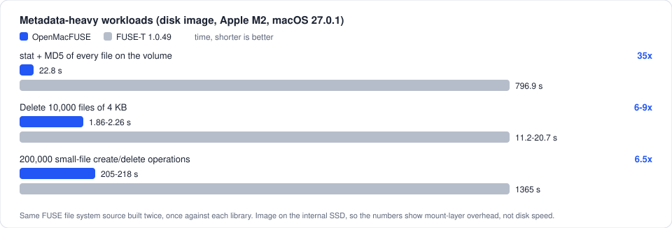

# OpenMacFUSE

[English](README.md) | [简体中文](README.zh-CN.md) | **日本語** | [Deutsch](README.de.md) | [Français](README.fr.md) | [Español](README.es.md)

**カーネル拡張もインストール作業も不要な、macOS 向けの FUSE 2.x 互換ライブラリ。**

OpenMacFUSE は、ファイルシステムのプロセス内で NFSv4.0 サーバーを動かし、macOS 標準の NFS クライアントでそれをマウントします。`fuse_operations` のコールバックはそのまま使えます。FUSE ライブラリの代わりに、静的ライブラリ `libopenmacfuse.a` を 1 つリンクするだけです。

[NTFSTool Pro](https://ntfstool.com) に組み込まれているマウントエンジンであり、NTFS、ext2/3/4、exFAT、BitLocker の各ボリュームを扱っています。出荷中の製品のために書かれたもので、以下の測定値はその開発過程で得られたものです。

> **ステータス: v0.9 プレビュー。** macOS 12（Intel）と macOS 27（Apple シリコン）で全項目をテスト済みです。macOS 13 から 26 は未テストです。[テスト済みの環境](#テスト済みの環境)を参照してください。


## なぜ作ったか

macOS 11 以降、サードパーティのカーネル拡張は、ユーザーがリカバリモードでセキュリティレベルを下げない限り読み込まれません。一般ユーザー向けのソフトウェアにとって、これはもはや現実的な要件ではありません。ユーザー空間のファイルシステムには、macOS が最初から備えている NFS クライアントを経由するという別の道があります。同じマシン上で NFS サーバーを動かし、NFS リクエストを 1 つずつファイルシステムの呼び出しに変換し、`mount_nfs` でマウントする方法です。

OpenMacFUSE はこの方式を採り、サーバー全体をファイルシステムのプロセス内に収めています。

- **インストール不要。** カーネル拡張もシステム拡張もインストーラもなく、Apple シリコンで「低セキュリティ」に切り替える必要もありません。静的ライブラリ 1 つだけです。
- **単一プロセス。** NFS サーバーとファイルシステムがアドレス空間を共有します。リクエストはプロトコルデコーダからコールバックまで関数呼び出しで届き、2 つ目のプロセスも余分なコピーもありません。
- **メモリ使用量に上限あり。** 固定サイズのバッファプール、上限付きのノードテーブル、上限付きのディレクトリスナップショット。メモリはファイルサイズ、ファイル数、稼働時間に応じて増えません。
- **フェイルクローズ。** デバイスが消えた場合、プロセスがハングした場合、強制終了された場合には、マウントは数秒以内に解除されます。アプリケーションが応答しないボリュームでブロックされたままになることはありません。
- **Mac 固有のセマンティクスはライブラリ側で処理。** ボリューム上に `._` ファイルを作らない拡張属性、大文字と小文字を区別しない検索、NFC/NFD のファイル名。
- **クリーンルーム実装の C。** 約 17,000 行。RFC 7530、7531、5531、4506 と公開されている FUSE 2.x API をもとに書かれています。サードパーティのコードは含みません。MIT ライセンス。

## 測定結果

数値はすべて NTFSTool のエンジニアリングチームが測定したものです。同一の FUSE ファイルシステムのソース（NTFSTool Pro の NTFS ドライバ）を、OpenMacFUSE 向けと FUSE-T 1.0.49 向けに 1 回ずつビルドし、同じマシン上で同じボリュームイメージを使って実行しました。測定方法、使用マシン、全データの表は [docs/BENCHMARKS.md](docs/BENCHMARKS.md) にあります。




実際の USB ディスクでは、大きなシーケンシャル転送はディスク側の性能で頭打ちになり、両者に差はありません。

| 実ディスク | OpenMacFUSE | FUSE-T 1.0.49 |
|---|---|---|
| USB SSD、シーケンシャル書き込み 4.5 GB | 293-313 MB/s | 300 MB/s |
| USB SSD、コールドリード | 245-251 MB/s | 236-241 MB/s |
| USB SSD、小さなファイル 2,000 個の削除 | 0.82-0.86 s | 8.4-9.7 s |
| USB SSD、ディレクトリツリーの走査 | 0.25-0.30 s | 4.1-4.6 s |
| USB ハードディスク、書き込み / 読み出し | 70 / 97 MB/s | 74 / 93 MB/s |

小さなファイルの作成は掲載していません。これらの測定の後にファイルシステムの耐久性設定の既定値が変わり、その比較をまだやり直していないためです。

同じボリュームイメージを macOS 12.7.6 の Intel Mac にマウントし、40,000 個のファイルを含むディレクトリを一覧表示したあと、マウントプロセスのメモリフットプリントを読み取った結果です。

| OpenMacFUSE | FUSE-T 1.0.49 |
|---|---|
|  |  |
| 初回の一覧表示 4.06 s、フットプリント 43 MB | 初回の一覧表示 7.90 s、フットプリント 209 MB |

### 異常が起きたとき

| 事象 | 動作 |
|---|---|
| 書き込み中にディスクを抜いた | 書き込み側にエラーが返り、マウントは 0.2-0.5 s で消える |
| アイドル中または読み出し中にディスクを抜いた | 約 1.2-1.4 s でアンマウントされる |
| あるリクエストが 30 s 進捗しない | ウォッチドッグが保留中のリクエストを失敗させ、強制アンマウントして終了する |
| ファイルシステムのプロセスがクラッシュした、または強制終了された | ガードプロセスが約 2 s でマウントを取り除く |
| 6 時間連続の混合負荷 | メモリは開始時 45 MB、終了時 51 MB（+0.27 MB/時） |

ガードがない場合、NFS サーバーが死んでもクライアントの `deadtimeout`（約 70 s）が切れるまでマウントは残り続け、その間、そこにアクセスしているプロセスは中断できません。

## クイックスタート

必要なもの: Xcode Command Line Tools が入った macOS。ほかには何も要りません。

```sh
git clone https://github.com/ntfstool/openmacfuse
cd openmacfuse
make              # build/libopenmacfuse.a (+ build/openmacfuse-m0, an in-memory test server)
make universal    # arm64 + x86_64
make -C examples/hello
mkdir -p /tmp/hello && examples/hello/hello /tmp/hello
cat /tmp/hello/hello.txt      # Hello from openmacfuse
umount /tmp/hello             # hello exits after the unmount
```

初回のマウント時に、呼び出し元のアプリに対して macOS の「ネットワークボリューム」アクセス許可のダイアログが表示されることがあります。NFS マウントなので、これは想定どおりの動作です。

## 自分のファイルシステムで使う

```c
#define FUSE_USE_VERSION 26
#include <fuse.h>
```

```sh
cc -I/path/to/openmacfuse/include -c myfs.c
cc -o myfs myfs.o /path/to/openmacfuse/build/libopenmacfuse.a \
   -lpthread -framework CoreFoundation -framework IOKit
```

FUSE 2.x 高レベル API の 2 つの書き方は、どちらも使えます。

```
fuse_main(argc, argv, &ops, NULL)
```

```
fuse_mount → fuse_new → fuse_set_signal_handlers → [daemon()] → fuse_loop → fuse_unmount → fuse_destroy
```

`fuse_new` が戻った時点でマウントは完了しています。`fuse_loop` は、ボリュームがアンマウントされた後、デバイスの喪失が報告された後、または SIGINT/SIGTERM/SIGHUP を受けたときに戻ります。

[`examples/hello/hello.c`](examples/hello/hello.c) は 150 行に満たない、完結した読み取り専用ファイルシステムです。`write` コールバックを実装し、`-o ro` を付けずにマウントすれば、ファイルシステムは読み書き可能になります。

### ファイルシステム側で必ず守ること 2 点

1. **`getattr` で、すべてのオブジェクトについて安定した一意の `st_ino` を返すこと。** NFS のファイルハンドルは inode 番号から組み立てられます。ファイルシステムが `st_ino` をゼロのままにした場合は、ライブラリがパスをもとに安定した番号を割り当てます。
2. **`fsync` に、`COMMIT` に持たせたい意味を持たせること。** ライブラリは NFS の `COMMIT` と `FILE_SYNC` 書き込みに対して `fsync` を呼び出します。耐久性に関する合図はこれ以外にありません。

### マウントオプション（`-o`）

| オプション | 効果 |
|---|---|
| `volname=NAME` | macOS が表示するボリューム名 |
| `ro` / `rdonly` | 読み取り専用でマウント |
| `rwsize=N` | NFS の読み書きサイズ（既定値 262144） |
| `nobrowse` | ボリュームを Finder に表示しない |
| `nosuid`, `nodev`, `noexec` | そのままマウントに渡される |
| `openmacfuse_case=insensitive\|sensitive` | 大文字と小文字を区別しない検索（既定）。大文字と小文字だけが異なる名前がすでにボリューム上にある場合は、自動的に `sensitive` に切り替わる |
| `openmacfuse_xattr=adfile\|appledouble\|streams` | 拡張属性の格納先。`adfile`（既定）: クライアントが作る `._` ファイルをライブラリが `setxattr`/`getxattr` の呼び出しに変換するため、ボリュームに余分なものは保存されない。`appledouble`: 通常の `._` ファイル。`streams`: NFSv4 の名前付き属性。実験的機能で、「既知の制限」を参照 |
| `openmacfuse_nfc=1\|0` | 新しい名前を Unicode NFC で保存する（既定値 1）。どちらの設定でも、検索は NFC と NFD の両方を受け付ける |

一般的な FUSE オプション（`local`、`allow_other`、`fsname`、…）は受け付けたうえで無視します。`fuse_main` 経由で起動するプログラムには、これらのオプションを明示的に渡さない限り、保守的な既定値（`openmacfuse_xattr=appledouble`、`openmacfuse_case=sensitive`）が適用されます。

### 環境変数

| 変数 | 既定値 | 効果 |
|---|---|---|
| `OPENMACFUSE_TRANSPORT` | `auto` | `unix`、`tcp`、または `auto`（macOS 26+ では unix ソケット、それより前は 127.0.0.1 の TCP） |
| `OPENMACFUSE_LOG` | — | このファイルにログを追記する |
| `OPENMACFUSE_WATCHDOG_S` | 30 | リクエストがハングしたとみなすまでの、進捗のない秒数。0 で無効 |
| `OPENMACFUSE_WATCHDOG_MAX_S` | 600 | 1 リクエストあたりの絶対的な上限。0 で無効 |
| `OPENMACFUSE_GUARD` | 1 | 0 = ガードプロセスを起動しない |
| `OPENMACFUSE_GUARD_S` | 20 | ガードがプロセスをフリーズしたと判断するまでの、ハートビートのない秒数 |
| `OPENMACFUSE_MOUNT_TIMEOUT_S` | 30 | `mount_nfs` のタイムアウト |

任意の拡張コールバック（ケースフォールディング、範囲指定の xattr 入出力、ウォッチドッグ用の進捗カウンタ、マウント情報）は [`include/openmacfuse.h`](include/openmacfuse.h) で宣言されています。

## 仕組み

macOS の NFS クライアントは古くからあり、安定していて、必ず入っています。OpenMacFUSE は、ローカルの unix ソケット（macOS 26 以降）または 127.0.0.1 の TCP（それより前のバージョン。この場合、ほかのローカルプロセスからの接続は拒否します）を介してこのクライアントと NFSv4.0 で通信し、COMPOUND リクエストを 1 つずつ FUSE の高レベルコールバックに変換します。

動作を特徴づけている設計上の判断をいくつか挙げます。

- **上限付きのノードテーブル。** ファイルハンドルはメモリ上のオブジェクトへのポインタではありません。テーブルには上限があり、追い出されたハンドルは次に使われたときにパスから解決し直されます。上限を 64 エントリまで強制的に下げ、リネームを 301 回連続で行った試験では、古いハンドルに対する 7,839 回の参照がすべて解決され、`NFS4ERR_STALE` は 1 回も返りませんでした。
- **重複リクエストキャッシュ。** クライアントはタイムアウト後にリクエストを再送します。冪等でない操作（`CREATE`、`REMOVE`、`RENAME`、…）への応答はキャッシュして再生するため、操作が実行されるのは 1 回だけです。
- **既定では名前付き属性を使わない。** NFSv4 の名前付き属性は拡張属性の格納先として自然ですが、開発中、これを有効にしたところ macOS の NFS クライアント内でカーネルパニックが発生しました（macOS 27.0.1 と 12.7.6 で確認）。既定の経路では、クライアントが最もよく使う機能だけを使います。

設計メモとプロトコル上のトレードオフ: [docs/DESIGN.md](docs/DESIGN.md)。

## テスト済みの環境

| macOS | ハードウェア | 結果 |
|---|---|---|
| 12.7.6 | Intel (MacBookPro11,4) | フルスイート、869 件の自動チェックに合格 |
| 27.0.1 | Apple シリコン (M2) | 読み書き、抜去のシミュレーション、強制終了、Mac セマンティクスのスイートに合格 |
| 13, 14, 15, 26 | — | **未テスト** |

フルスイートは実際のファイルシステム（NTFS、ext、exFAT）を対象に動かしますが、それらはこのリポジトリには含まれていません。このリポジトリだけで実行できるのは次のものです。

```sh
make test               # unit tests, no mount
tests/m0_smoke.sh       # mount the in-memory server, read, unmount
```

## 既知の制限

- **未テストの macOS バージョン**: 13、14、15、26。
- **macOS から見ると、ボリュームはネットワークボリュームです。** ゴミ箱は使えず、非常に大きなディレクトリ（40,000 エントリ以上）を Finder で最初に開くときは時間がかかります。
- **macOS の NFS クライアント内で起きるカーネルパニックは、ユーザー空間からは捕捉できません。** 開発中に遭遇した 2 つの経路（名前付き属性、および応答しないサーバーへのマウントの中断）は、既定で避けるようにしています。
- **API の対応範囲**: FUSE 2.x 高レベル API。提供していないもの: 低レベル API、FUSE 3。
- **コールバックは直列化されています**（グローバルロック 1 つ）。遅いデバイス上の遅いリクエストは、同じマウントのほかのリクエストを待たせます。
- FUSE 2.x には **inode の世代番号がありません**。ファイルシステムが削除後に inode 番号を再利用する場合、古いハンドルを持つクライアントが新しいファイルに到達することがあります。
- **ファイルフラグ**: 不可視フラグとアーカイブフラグは `chflags` コールバックに渡されます。Finder の「ロック」フラグ（`uchg`）は渡されません。macOS の NFS クライアントがリクエストを送らずに拒否するためです。

## 関連プロジェクト

- [NTFSTool Pro](https://ntfstool.com): Mac 向けの NTFS 読み書きツール。ext2/3/4、exFAT の復旧、BitLocker にも対応。OpenMacFUSE はその内蔵マウントエンジンです。
- [ntfstool/ntfstool](https://github.com/ntfstool/ntfstool): Apple FSKit をベースにした、無料でオープンソースの NTFSTool。

OpenMacFUSE は、カーネル拡張を必要としない数少ないオープンソースの macOS 向け FUSE 実装のひとつです。独立したプロジェクトであり、macFUSE およびその作者とは提携関係になく、libfuse プロジェクトや FUSE-T プロジェクトとも関係ありません。「FUSE」は API を指します。

## コントリビューション

[CONTRIBUTING.md](CONTRIBUTING.md) を参照してください。セキュリティ上の問題: service@ntfstool.com。

## ライセンス

MIT。[LICENSE](LICENSE) と [NOTICE](NOTICE) を参照してください。
